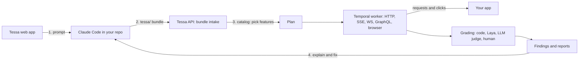

# Tessa

[](LICENSE)


**Tessa is an open-source QA harness that tests your app from the outside, with Claude Code as the engineer who knows your code.**

Point Tessa at a QA deployment of any web app or API. Claude Code reads your repo and tells Tessa what the app does. Tessa then plans the tests, runs them through real HTTP calls and a real browser you can watch live, grades every step and hands the failures back to Claude Code to explain and fix.

**Contents:** [What it does](#what-it-does) · [How it works](#how-it-works) · [Quick start](#quick-start) · [Documentation](#documentation) · [Contributing](#contributing) · [License](#license)

Tessa calls your app the way a user or client would: HTTP requests, streams, webhooks, WebSockets, GraphQL and a real browser you can watch live. It plans the tests, runs them, grades every step and reports what broke. It never needs access to your source code. The repo-aware work (reading the code, writing test bundles, explaining failures, fixing bugs) is done by Claude Code on your own machine.

> **Status: early and experimental.** The core loop (targets, bundles, the catalog, runs over HTTP and the browser, grading, findings) has been run end to end. Many later features were written but have not yet been tested end to end. Expect rough edges, and please open an issue when something breaks.

## What it does

- **Learns your app from a bundle.** Claude Code reads your repo and writes a `tessa/` folder: a manifest of features, roles and interfaces, an env template, seed data, reference SQL queries and UI flows.
- **Shows you what it can test.** You upload the bundle and Tessa turns it into a catalog. You pick the features, roles and depth.
- **Runs the tests.** Runs are durable Temporal workflows. API steps and real Chromium browser sessions run in parallel, and the browser tiles stream live to the web app.
- **Grades every step.** Grading goes in tiers: code checks first, then a small local model (Laya) for short texts, then an LLM judge, then a human. "Uncertain" is its own verdict and never counts as a pass.
- **Reports findings.** Failures become de-duplicated findings with a repro, a transcript and screenshots. Claude Code can explain a finding, fix it on a branch and re-run only that scenario.
- **Measures the suite itself.** Mutation testing, flakiness tracking, judge-versus-human agreement, schedules, reports and Slack notifications.

## How it works



1. Tessa writes a **prompt** for you.
2. Claude Code, open in your repo, does the repo work and returns a **bundle**. With the Tessa plugin, Claude Code calls Tessa directly and nothing is copied by hand.
3. Tessa validates the bundle, plans, runs, grades and reports.
4. Findings go back to Claude Code to explain and fix.

Tessa never holds your repo or your secrets in the clear. Bundles carry placeholders, and the real values live in an encrypted store.

| Part | Folder | Stack |
|---|---|---|
| Web app | [`client/`](client/) | Next.js 16, React, Tailwind, shadcn/ui |
| API | [`api/`](api/) | FastAPI, Python 3.13, SQLAlchemy, Alembic |
| Worker | [`worker/`](worker/) | Temporal Python SDK, Playwright, Schemathesis |
| Database | [`deploy/docker-compose.yml`](deploy/docker-compose.yml) | Postgres 17 with pgvector |
| Claude Code plugin | [`plugin/`](plugin/) | TypeScript MCP server, skills and hooks |
| Published formats | [`schemas/`](schemas/) | JSON Schemas for bundles, scenarios, findings and more |

## Quick start

You need Docker, [uv](https://docs.astral.sh/uv/), Node 22.12 or newer and the [Temporal CLI](https://docs.temporal.io/cli). Run each block from the repository root, each in its own terminal:

```bash
# 1. Database
git clone https://github.com/Rohitjangid2704/Tessa.git && cd Tessa
cp deploy/.env.example deploy/.env
docker compose -f deploy/docker-compose.yml up -d --wait postgres

# 2. Temporal (leave it running)
mkdir -p deploy/data
temporal server start-dev --db-filename deploy/data/temporal.db

# 3. API (leave it running)
cd api && uv sync && cp .env.example .env
uv run alembic upgrade head
uv run uvicorn tessa_api.main:app --reload --port 8000

# 4. Worker (leave it running)
cd worker && uv sync && cp .env.example .env
uv run playwright install chromium
uv run python -m tessa_worker.main

# 5. Web app (leave it running)
cd client && npm install && cp .env.example .env.local
npm run dev
```

Open <http://localhost:3000> and sign in with the local admin account:

| Email | Password |
|---|---|
| `admin@tessa.local` | `dev-only-admin-password-1` |

These credentials are for a local machine only. Change them before anyone else can reach your Tessa (see [Accounts and secrets](docs/05-accounts-and-secrets.md)).

To look around the web app without the backend, run `cd client && npm install && cp .env.example .env.local && npm run dev:mock`. It starts a mock API.

## Documentation

Read the step-by-step guides in [`docs/`](docs/README.md):

1. [Requirements](docs/01-requirements.md)
2. [Database and services](docs/02-database-and-services.md): Postgres, Temporal and Laya
3. [Backend](docs/03-backend.md): the API and the worker
4. [Frontend](docs/04-frontend.md): the web app
5. [Accounts and secrets](docs/05-accounts-and-secrets.md): the login, users, keys and production settings
6. [Using Tessa](docs/06-using-tessa.md): from your first target to your first findings
7. [Using Tessa with Claude Code](docs/07-claude-code.md): the plugin and its skills
8. [How it works](docs/08-how-it-works.md): architecture and design rules
9. [Troubleshooting](docs/09-troubleshooting.md)

## Contributing

Contributions are welcome. See [CONTRIBUTING.md](CONTRIBUTING.md). To report a security problem, follow [SECURITY.md](SECURITY.md) and don't open a public issue.

## License

[MIT](LICENSE)
