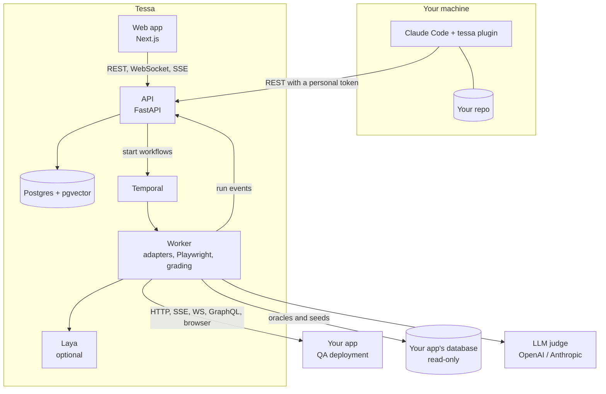

# 8. How it works

## The idea

Most test tools either live inside the codebase (unit and integration tests) or know nothing about it (black-box crawlers). Tessa splits the job:

- **Tessa holds the harness.** It plans, runs, grades and reports. It tests from the outside, the way a user or client would, and keeps the history: runs, verdicts, findings and trends.
- **Claude Code holds the repo.** It reads the code on your machine and does the work that needs it: describing the app, writing scenarios, explaining failures, fixing bugs, planting mutants.
- **You hold the decision** at every hand-off: what to test, which scenarios to accept, what to deploy.

They meet in the **prompt round-trip**. Tessa writes a versioned prompt, Claude Code does the repo work, and the result comes back as a bundle or an explanation that Tessa validates before it changes anything.

## Architecture

| Component | Role |
|---|---|
| **Web app** (`client/`) | the screens: targets, bundles, the catalog, plans, live runs, steps, findings, coverage, settings. It talks only to the API |
| **API** (`api/`) | the source of truth. It stores everything in Postgres, validates bundles and scenarios, composes prompts, starts workflows and fans run events out to the browser over WebSocket and SSE |
| **Temporal** | durable control flow. A run survives a restart of the worker or the API |
| **Worker** (`worker/`) | runs the workflows: seeds the data, drives each scenario through its adapters, records the evidence, grades each step and files findings |
| **Plugin** (`plugin/`) | a local MCP server with 28 tools and 9 skills that let Claude Code drive the API |
| **Schemas** (`schemas/`) | the published formats: bundle, scenario, probe, finding, proposal, stream events and more |

## A run, step by step

1. **Plan.** You pick catalog cells, and the API saves a plan with a budget.
2. **Snapshot.** The run records its exact config: bundle version and hash, seed hash, clock, model and effort per role, prompt and probe-bank versions, scenario versions. Any run can be reproduced from it.
3. **Seed.** The seed script resets the test data, and a seed gate checks the hash before anything runs.
4. **Drive.** Each scenario runs its steps through an adapter: `http`, `sse`, `browser` (Playwright Chromium with live frames), `websocket` or `graphql`.
5. **Grade.** Each step climbs a ladder and stops at the first tier that can decide:
   1. **Code:** status codes, schemas, oracle comparisons and Tier-0 checks such as leaked secrets.
   2. **Laya:** typed yes or no questions about short texts, run locally on the CPU.
   3. **LLM judge:** for what is left, with a tie-break judge when the first is unsure.
   4. **Human:** anything still uncertain goes to the label queue.
6. **Triage.** Failures are de-duplicated by meaning (pgvector embeddings) into findings. Invariants, such as no leaked IDs or latency limits, run across the whole run.
7. **Report.** The verdicts, the cost, the duration, an HTML and JSON report, and notifications.

## Design rules

1. **Control flow is code.** Every pipeline is a Temporal workflow, and a model never decides what runs next.
2. **Models are called only at named activities,** each with an input schema, an output schema, a budget and a timeout.
3. **Every model output is validated** and dry-run (a scenario must pass twice on the seeded environment) before it changes state, and is accepted by a person while trust is being earned.
4. **Every verdict carries a tier and a confidence.** "Uncertain" is a status, never a pass.
5. **Every run is reproducible** from its config snapshot.
6. **Budgets are hard.** Over budget, the run stops. It never silently degrades.
7. **Tessa never holds a repo,** and holds secrets only encrypted, never returning them.
8. **Every finding can be reproduced by a person** from its scenario, seed, clock, transcript and screencast.
9. **The suite is measured,** with mutation score, judge-versus-human agreement (κ) and pass^k, not only pass rates.
10. **Nothing is skipped silently.** A family whose service is down is skipped with a reason, never shown green.

## Repository layout

| Path | What it is |
|---|---|
| `api/tessa_api/` | `main.py` (the app factory), `settings.py`, `routers/` (one module per resource), `services/` (domain logic), `schemas/` (wire models and the published formats), `streams/` (run events, WebSocket and SSE), `db/models/`, `auth/` |
| `api/alembic/` | database migrations |
| `api/prompts/` | the versioned prompt templates Tessa gives to Claude Code, pinned by sha256 |
| `worker/tessa_worker/` | `workflows/`, `activities/`, `adapters/` (http, sse, browser, websocket, graphql), `checks/` (Tier-0), `grading/`, `findings/`, `invariants/`, `fuzz/` (Schemathesis), `mutation/`, `reports/`, `lab/` |
| `worker/tests/fake_target/` | a small fake app with a switchable known defect, used by the tests and the smoke run |
| `client/app/` | Next.js routes |
| `client/features/` | one folder per domain (targets, runs, findings and so on) |
| `client/mocks/` | the mock API for `npm run dev:mock` |
| `plugin/` | the Claude Code plugin: `server/` (MCP server), `skills/`, `hooks/`, `bin/tessa-loop` |
| `probes/` | the Laya question bank and the red-team attack packs |
| `schemas/` | the published JSON Schemas, exported from the Pydantic models |
| `deploy/` | Docker Compose, Postgres init scripts, Laya, Kubernetes manifests, the CI commit gate, the smoke tests |

Next: [Troubleshooting](09-troubleshooting.md)
